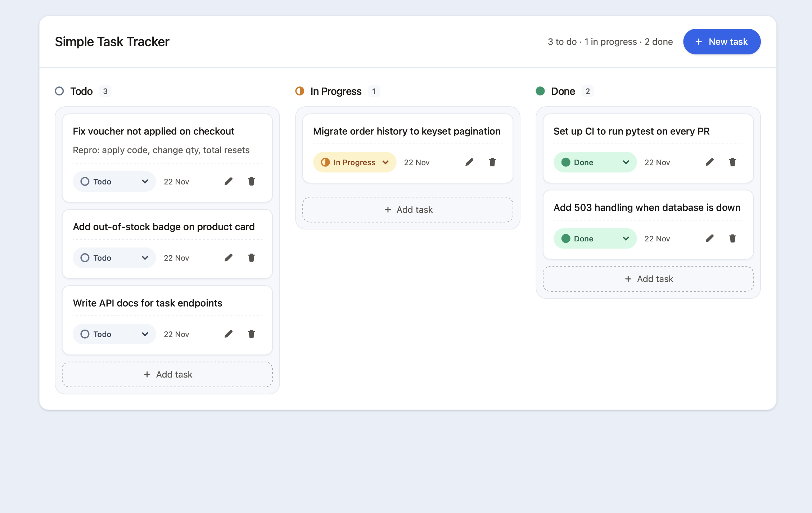
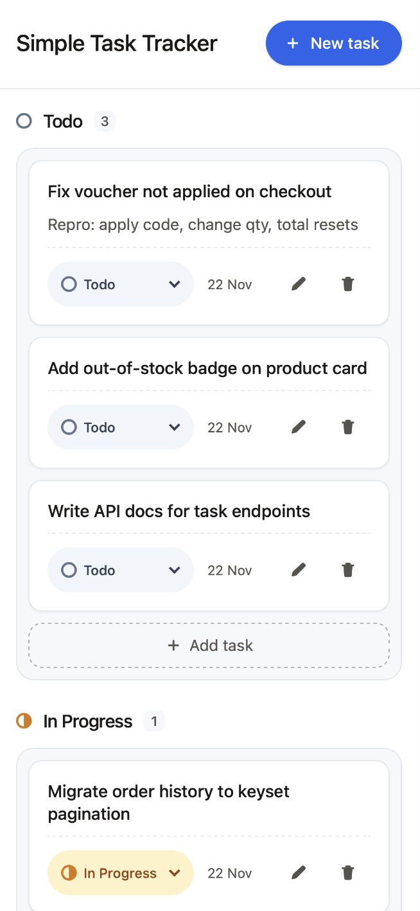

# Simple Task Tracker

A small task board for one product squad, built with FastAPI, PostgreSQL and React for a technical test.





## Features

- Create, list, edit and delete tasks, each with a title, an optional description and a status
- A board with three columns: Todo, In Progress and Done. The status is changed from a pill on each card
- Add, edit and delete-confirmation in native `<dialog>` windows (Esc closes, focus stays inside)
- `GET /tasks?status=` filter in the API (the board itself loads every task and groups them by column)
- The same validation rules on both sides: the form checks what the API checks, and API errors appear next to the field
- Loading, empty, "can't reach the server" and "database unavailable" states, with a Try again button
- Notifications stack in the top right: successes fade after 3 seconds, errors stay until dismissed
- Responsive: three columns from 768px, stacked on phones, no horizontal scroll at 375px
- Basic accessibility: real labels, visible focus, keyboard-only use, status shown in words and not only by colour
- 17 API test cases (pytest) against a real PostgreSQL test database

## Tech stack & why

| Part | Choice (version) | Why |
|---|---|---|
| API | FastAPI 0.165.0 + Uvicorn 0.54.0 | Validation and interactive docs (`/docs`) come from type hints, so there is little hand-written validation code |
| Validation | Pydantic 2.14.4 | Pinned so every machine accepts and rejects exactly the same input |
| Config | pydantic-settings 2.16.3 | Reads and type-checks `backend/.env`; a missing or misspelled key stops the app at startup |
| Database access | SQLAlchemy 2.1.9 (sync) + psycopg 3.3.9 (binary) | ORM with bound parameters and a connection pool; the binary wheel needs no compiler |
| Database | PostgreSQL 18 (`postgres:18-alpine`) | Required by the brief; Docker Compose starts it with one command |
| Tests | pytest 9.2.0 + httpx2 2.16.2, ruff 0.17.6 | Tests call the API in-process; ruff lints and formats in one tool |
| Frontend | React 19 + Vite 8, JavaScript | Small UI with one custom hook for state; no TypeScript to keep five components easy to read |
| Styling | Tailwind CSS 4.3.5 (`@tailwindcss/vite`) | Utility classes with colour tokens in one place (`index.css`), no config file |
| HTTP client | `fetch` | Built into the browser; a 50-line wrapper (`api/tasks.js`) handles JSON and errors, so no axios |

## Prerequisites

- Python 3.11+ (developed on 3.15, which the pinned packages install cleanly on)
- Node.js 22.12+ (24 LTS recommended)
- Docker Desktop, or a local PostgreSQL server
- Git

## Quick start

Run every command from the repository root unless a step says otherwise.

### 0. Get the code

```bash
git clone <repo-url> simple-task-tracker
cd simple-task-tracker
```

### 1. Start the database

macOS / Linux:

```bash
cp backend/.env.example backend/.env
docker compose up -d --wait        # starts PostgreSQL 18 and waits until it is healthy
```

Windows (PowerShell):

```powershell
Copy-Item backend\.env.example backend\.env
docker compose up -d --wait
```

PostgreSQL listens on port **5433** on your machine (5432 inside the container), so it does not clash with a PostgreSQL you may already have on 5432.
On first start it also creates the `tasks_test` database used by the test suite.

Check that both databases exist:

```bash
docker compose exec db psql -U tasks_user -d tasks -c '\l'
```

The list should contain `tasks` and `tasks_test`.

### 2. Start the API

macOS / Linux:

```bash
cd backend
python3 -m venv .venv
source .venv/bin/activate
pip install -r requirements.txt
uvicorn app.main:app --reload
```

Windows (PowerShell):

```powershell
cd backend
python -m venv .venv
.venv\Scripts\Activate.ps1
pip install -r requirements.txt
uvicorn app.main:app --reload
```

The API runs on http://localhost:8000 and the interactive docs are at http://localhost:8000/docs.
The `tasks` table is created automatically on startup, so the database must be running first.
`uvicorn` keeps running in this terminal; leave it open and use a new terminal for the next steps.

### 3. Start the frontend

In a new terminal, from the repository root.

macOS / Linux:

```bash
cp frontend/.env.example frontend/.env
cd frontend
npm install
npm run dev
```

Windows (PowerShell):

```powershell
Copy-Item frontend\.env.example frontend\.env
cd frontend
npm install
npm run dev
```

Open http://localhost:5173. The app talks to the API at `VITE_API_URL` from `frontend/.env`.

## Setup without Docker

You need a local PostgreSQL server on port 5432. Create the user and both databases as a superuser
(on Linux, prefix each command with `sudo -u postgres`):

```bash
psql -d postgres -c "CREATE USER tasks_user WITH PASSWORD 'change-me';"
psql -d postgres -c "CREATE DATABASE tasks OWNER tasks_user;"
createdb -O tasks_user tasks_test
```

Then copy the env file as in step 1 and set `DB_PORT=5432` in `backend/.env`.
The password must match `POSTGRES_PASSWORD` in that file. The remaining steps are the same.

## Running tests

The tests run against the separate `tasks_test` database, so the database from step 1 must be running.
They never touch the `tasks` database you use while developing.

In a new terminal, from the repository root (on Windows, activate with `.venv\Scripts\Activate.ps1` instead):

```bash
cd backend
source .venv/bin/activate
pip install -r requirements-dev.txt
pytest -v
```

## API reference

Base URL: `http://localhost:8000`. All bodies are JSON. Full schema: http://localhost:8000/docs.

| Method | Path | Body | Success | Errors |
|---|---|---|---|---|
| `GET` | `/tasks` | none; optional query `status` (`Todo`, `In Progress` or `Done`) | `200` list, newest first | `422`, `503` |
| `POST` | `/tasks` | `title` (required, 1–120 chars after trimming spaces), `description` (optional, up to 2000 chars), `status` (optional, default `Todo`) | `201` created task | `422`, `503` |
| `PUT` | `/tasks/{task_id}` | any of `title`, `description`, `status`; fields that are sent cannot be `null` | `200` updated task | `404`, `422`, `503` |
| `DELETE` | `/tasks/{task_id}` | none | `204` empty body | `404`, `422`, `503` |

- `404`: `{"detail": "Task not found"}`
- `422`: FastAPI's standard validation error, `{"detail": [...]}` with the failing field in `loc`
- `503`: `{"detail": "Database unavailable"}` when PostgreSQL cannot be reached
- Status values are case-sensitive. Unknown fields are rejected with `422`.

## Project structure

```text
.
├── docker-compose.yml          # PostgreSQL 18 on host port 5433
├── db/init/                    # creates the tasks_test database on first start
├── backend/
│   ├── app/
│   │   ├── main.py             # app, lifespan (create tables), CORS, 503 handler
│   │   ├── config.py           # settings read from backend/.env
│   │   ├── database.py         # engine, session per request (get_db)
│   │   ├── models.py           # Task table + TaskStatus enum (single source of status values)
│   │   ├── schemas.py          # request/response shapes and validation
│   │   └── routers/tasks.py    # the 4 endpoints
│   └── tests/                  # pytest, runs against tasks_test
└── frontend/
    └── src/
        ├── api/tasks.js        # every HTTP call, ApiError
        ├── hooks/useTasks.js   # all task state
        ├── constants.js        # statuses and length limits shared by the UI
        ├── App.jsx             # page, header, dialogs, notifications
        └── components/         # TaskForm, TaskColumn, TaskCard, Notice
```

## Design decisions & trade-offs

**Two bugs found while prototyping, before writing the real code**

1. **`PUT {"title": null}` passed validation and crashed in the database.** In the update schema every field is optional (`str | None = None`), so an explicit `null` is valid input. The router then wrote `None` into a `NOT NULL` column and the API answered 500. Fix: a `reject_null` validator on `TaskUpdate`. Pydantic does not validate defaults, so it only runs for fields the client actually sent: leaving a field out is fine, sending `null` is a 422.
2. **A 500 reaches the browser without CORS headers.** Starlette's `ServerErrorMiddleware` sits outside `CORSMiddleware`, so the response for an unhandled exception has no `Access-Control-Allow-Origin`. The browser then hides the real status and only reports a CORS or network error. Fix: an exception handler for `sqlalchemy.exc.OperationalError` (the database cannot be reached) returns 503 `{"detail": "Database unavailable"}`. Handlers run inside the CORS middleware, so the frontend can read it and show the right message. It is deliberately the only handler: any other database error is a bug and should stay a visible 500.

**Proof that the tests guard these rules.** Each rule was removed on purpose, the test suite was run, and the rule was restored (all 17 green again):

| Rule removed | Test that failed | Failure |
|---|---|---|
| `reject_null` validator (`schemas.py`) | `test_update_rejects_null_title` | `IntegrityError: null value in column "title"` |
| `CheckConstraint` on `status` (`models.py`) | `test_db_check_constraint_blocks_bad_status` | `DID NOT RAISE IntegrityError` |
| `extra="forbid"` on `TaskCreate` (`schemas.py`) | `test_create_rejects_unknown_field` | `assert 201 == 422` |
| `strip_whitespace=True` on `Title` (`schemas.py`) | `test_create_strips_title_whitespace`, `test_create_rejects_blank_title[   ]` | `assert '  Buy milk  ' == 'Buy milk'`, `assert 201 == 422` |

**Other decisions**

- **`PUT` updates only the fields that are sent** (`model_dump(exclude_unset=True)`), because the brief asks for a `PUT` that changes the title, description *or* status. `{}` is a valid no-op (200). In a project of my own, a partial update would be `PATCH`.
- **Status is `VARCHAR(20)` plus a `CHECK` constraint, not a native PostgreSQL `ENUM`.** Both the API (`TaskStatus` enum) and the database reject unknown values, and the constraint is built from the same enum so they cannot drift. Adding a status later is a constraint change, which is simpler than altering an `ENUM` type. Values are case-sensitive and written exactly as in the brief: `Todo`, `In Progress`, `Done`.
- **After each successful request the UI updates its list from the server's response**, not by refetching (one request per action instead of two) and not optimistically (no rollback logic). The server's copy, with its `id` and `updated_at`, stays the source of truth.
- **Tables are created with `Base.metadata.create_all()` at startup, not with Alembic.** It only creates missing tables and never alters existing ones. That is enough for a fresh clone; any schema change after real data exists needs migrations (see Next steps).
- **Add, edit and delete-confirmation all use one pattern: a native `<dialog>`.** The plan was inline editing and an inline delete confirmation. Dialogs won because there is one consistent way to change a task, cards never grow and push other cards around, and the browser provides the backdrop, Esc and focus trap without a library. The delete dialog names the task and focuses Cancel first.
- **Tests run against a real PostgreSQL database (`tasks_test`), not SQLite**, because `CHECK`, identity columns and `timestamptz` behave differently there. They never touch the development database.
- **Not deployed.** A repository that runs locally in a few minutes was a better use of the time than hosting, environment and CORS setup for a demo.

## If this grew

The current version is sized for one squad's board. Two directions would change it:

**As an internal tool for many squads**

- Single sign-on, a board per squad, and roles (who can edit, who can only view)
- Each task owned by a squad and user, with every query filtered by that ownership
- An audit log of who changed what
- Optimistic locking: the client sends the `updated_at` it saw, and the server answers 409 Conflict if someone saved in between

**At consumer scale**

- Keyset pagination on `(created_at, id)` instead of returning every task, since large `OFFSET`s get slower
- An index on `(status, created_at DESC)`, added after checking the query plan with `EXPLAIN ANALYZE`
- Alembic migrations, so the schema can change without dropping data
- Connection pool tuning, and a read replica for list queries
- Caching for read-heavy lists, and rate limiting per client
- Observability: structured logs, metrics and tracing

## Known limitations

- **Last write wins.** If two people edit the same task, the later save silently replaces the earlier one.
- **No authentication.** Anyone who can reach the API can change every task.
- **`GET /tasks` returns every task** (no pagination), which is fine for one squad but not for thousands of tasks.
- **An unexpected 500 looks like "Can't reach the server" in the browser**, because of the missing CORS headers explained above. Only "database unavailable" is turned into a readable 503.
- **`updated_at` changes only through the ORM.** An `UPDATE` run directly in SQL does not touch it (there is no database trigger).
- **Only the API has automated tests.** The frontend was tested by hand against a checklist (loading, empty, errors, keyboard, 375px and 1280px).
- **The Windows commands are written but were not run on Windows.** Everything else in this README was run on macOS.
- Nothing from the planned scope was cut.

## Next steps

In order of priority:

1. **Authentication and ownership**: the biggest gap as soon as more than one squad uses it.
2. **Alembic**: `create_all` cannot change an existing table, so the first schema change needs versioned migrations.
3. **Keyset pagination plus an index on `(status, created_at DESC)`**: so the list stays fast with thousands of tasks.
4. **Optimistic locking (409 Conflict)**: so concurrent edits warn instead of overwriting each other.
5. **Frontend tests (Vitest + Testing Library)**: so the UI states checked by hand are checked on every change.

## Troubleshooting

- **`env file .../backend/.env not found`**: the env file was not copied yet. Run the copy command from step 1.
- **Port 5433 is already in use**: change the left side of `"5433:5432"` in `docker-compose.yml` (for example `"5434:5432"`) and set the same number as `DB_PORT` in `backend/.env`.
- **`tasks_test` is missing, or you changed the credentials in `backend/.env`**: init scripts and credentials are only applied when the data volume is empty. Reset it (this deletes all data):

  ```bash
  docker compose down -v
  docker compose up -d --wait
  ```

- **The page says "Can't reach the server" although the API is running**: the frontend must run on an origin listed in `CORS_ORIGINS` in `backend/.env`. If port 5173 was busy, Vite picks another port (for example 5174); free 5173 or add the new origin to `CORS_ORIGINS`, then restart `uvicorn`.
- **Windows: `Activate.ps1 cannot be loaded because running scripts is disabled`**: allow scripts for the current PowerShell window only, then activate again:

  ```powershell
  Set-ExecutionPolicy -Scope Process -ExecutionPolicy Bypass
  ```

- **Safari: Tab skips the buttons**: by default Safari only tabs between form fields. Use Option+Tab, or turn on "Press Tab to highlight each item on a webpage" in Safari Settings → Advanced.

## Development notes
I used an AI coding assistant for research (library versions, framework behavior) and scaffolding.
All design decisions are mine, every line was reviewed, and I can walk through any part of the code.
